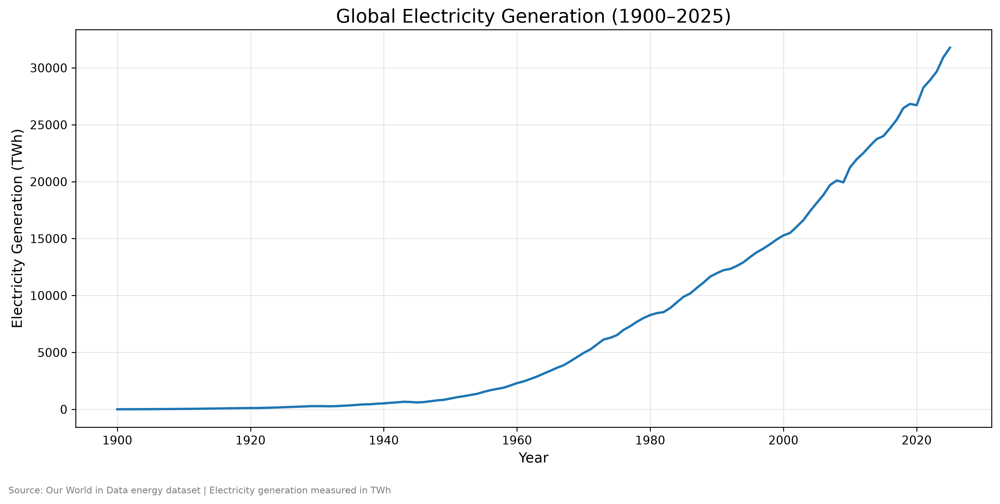
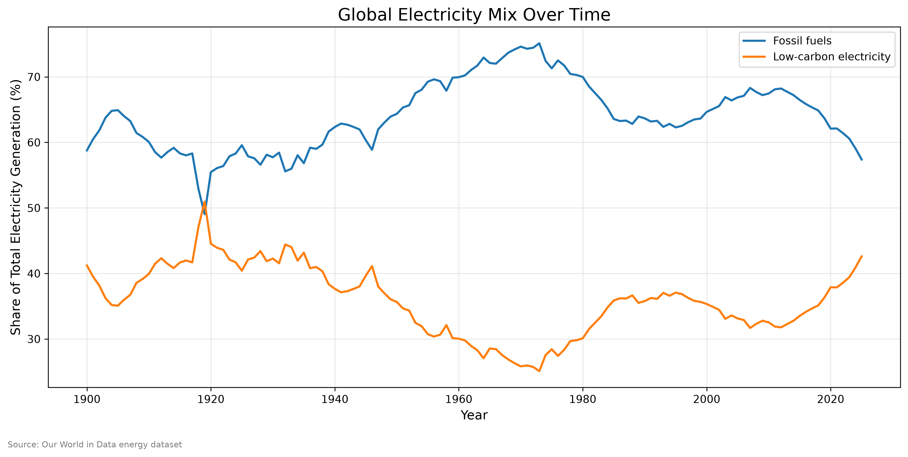
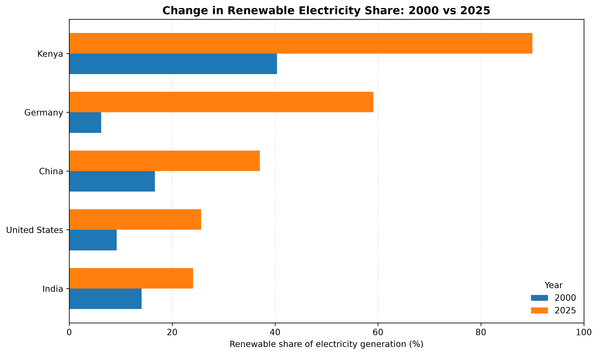
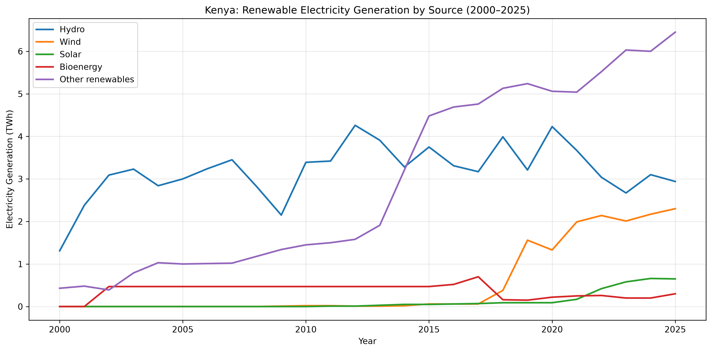

# Global Electricity Generation: Trends, Sources and Country Comparisons

## Project Overview

This project analyses global electricity generation from 1900 to 2025 using data from [Our World in Data (OWID)](https://ourworldindata.org/energy).

The analysis explores long-term changes in electricity generation, the contribution of different energy sources, and differences in electricity generation and energy mixes across selected countries.

The project also includes a focused analysis of Kenya's electricity generation, renewable energy sources and changes in its electricity mix between 2000 and 2025.

Python is used throughout the project for data inspection, cleaning, validation, analysis and visualisation.

## Project Objectives

- Analyse long-term trends in global electricity generation.
- Compare fossil fuel and low-carbon electricity generation.
- Examine the contribution and growth of individual electricity sources.
- Compare electricity generation across China, the United States, India, Germany and Kenya.
- Analyse changes in national electricity generation and energy mixes between 2000 and 2025.
- Investigate Kenya's renewable electricity generation and its evolution over time.
- Apply automated data quality checks to improve the reliability of the analysis.

## Tools and Technologies

- Python
- Pandas
- NumPy
- Matplotlib
- Seaborn
- Jupyter Notebook
- Git and GitHub

## Data Source

**Source:** Our World in Data (OWID), Energy dataset.

**Dataset:** [OWID Energy Dataset](https://catalog.ourworldindata.org/garden/energy/2026-09-10/owid_energy/owid_energy.csv)

**Dataset snapshot:** 10 September 2026.

The original dataset contains electricity generation information for countries and regional aggregates across multiple years.

Generation values are measured in terawatt-hours (TWh).

The project uses selected electricity generation variables from the original dataset. The raw dataset is retained separately from the cleaned analytical dataset.

## Project Structure

```text
project-1-electricity-generation/
│
├── data/
│   ├── raw/
│   │   └── owid_energy.csv
│   │
│   └── processed/
│       ├── electricity_generation_clean.csv
│       ├── country_generation_2025.csv
│       ├── country_electricity_mix_2025.csv
│       ├── country_electricity_growth_2000_2025.csv
│       ├── country_electricity_mix_change.csv
│       └── kenya_electricity_analysis_2000_2025.csv
│
├── notebooks/
│   └── electricity_generation_analysis.ipynb
│
├── src/
├── download_data.py
├── inspect_data.py
├── profile_electricity_data.py
├── clean_data.py
│
├── analyse_electricity.py
├── analyse_electricity_mix.py
├── analyse_energy_sources.py
├── calculate_source_growth.py
│
├── analyse_country_generation.py
├── analyse_country_growth.py
├── analyse_country_mix.py
├── analyse_country_mix_change.py
│
├── plot_country_growth.py
├── plot_country_mix.py
├── plot_country_mix_change.py
├── plot_country_percentage_growth.py
│
└── supporting investigation and validation scripts
│
├── tests/
│   └── test_data_quality.py
│
├── outputs/
│   └── figures/
│       ├── global_electricity_generation.png
│       ├── global_electricity_mix.png
│       ├── major_electricity_sources.png
│       ├── emerging_electricity_sources.png
│       ├── country_electricity_mix_2025.png
│       ├── country_generation_growth_2000_2025.png
│       ├── country_percentage_growth_2000_2025.png
│       ├── country_renewable_share_change.png
│       ├── kenya_electricity_generation_growth.png
│       ├── kenya_electricity_mix_trend.png
│       └── kenya_renewable_sources_trend.png
│
├── README.md
├── requirements.txt
└── .gitignore
```

## Methodology

### 1. Data Inspection

Inspected the original dataset to understand its structure, available variables, year coverage, missing values and duplicate records.

### 2. Data Cleaning

- Selected relevant electricity generation variables.
- Retained standard three-letter ISO-coded entities and the World aggregate.
- Checked for duplicate entity-year records.
- Reviewed missing and negative electricity generation values.
- Saved the cleaned dataset for subsequent analysis.

Missing values were not automatically treated as zero because an unavailable observation does not necessarily indicate zero electricity generation.

### 3. Data Quality Testing

Created automated tests using pytest to check:

- Required columns.
- Valid entity names and years.
- ISO code formatting.
- Duplicate entity-year records.
- Negative electricity generation values.
- Missing electricity generation values.
- Electricity mix percentage consistency.

**All eight automated data quality tests passed** during project validation.

### 4. Exploratory Data Analysis

Used Pandas and NumPy to calculate electricity generation totals, source contributions, percentage shares, growth rates and compound annual growth rates (CAGR).

### 5. Data Visualisation

Used Matplotlib and Seaborn to create visualisations showing global electricity trends, energy source contributions, country comparisons and Kenya's renewable electricity development.

## Key Findings

### 1. Global Electricity Generation

Global electricity generation increased substantially between 1900 and 2025.

- 1900: approximately 6.36 TWh.
- 2025: approximately 31,772.35 TWh.

The analysis shows substantial long-term growth in global electricity production, with stronger expansion during the later decades.

### 2. Global Electricity Mix in 2025

In 2025:

- Fossil fuels accounted for approximately **57.39%** of global electricity generation.
- Low-carbon sources accounted for approximately **42.61%**.

Low-carbon electricity includes renewable sources and nuclear power.

The analysis also shows that the low-carbon share increased between 2010 and 2025, while the fossil fuel share declined over the same period.

### 3. Electricity Sources

In 2025:

- Coal remained the largest individual electricity source, contributing approximately **32.96%** of global generation.
- Natural gas contributed approximately **21.78%**.
- Hydropower contributed approximately **13.96%**.
- Solar and wind together contributed approximately **17.29%**.
- Oil-fired electricity generation declined between 2000 and 2025.

Solar and wind experienced particularly strong growth over the period, although their percentage growth rates are influenced by their relatively small starting values.

### 4. Country Comparisons

The analysis compared electricity generation across five selected countries in 2025.

| Country | Electricity generation (TWh) |
|---|---:|
| China | 10,583.36 |
| United States | 4,519.79 |
| India | 2,081.60 |
| Germany | 500.47 |
| Kenya | 14.04 |

China had the highest electricity generation among the five selected countries.

The electricity mix analysis also showed substantial differences in the contribution of renewable, fossil fuel and nuclear generation across these countries.

### 5. Changes in Renewable Electricity Share

Between 2000 and 2025, the renewable share of electricity generation increased in all five selected countries.

| Country | Change in renewable share |
|---|---:|
| Germany | +52.87 percentage points |
| Kenya | +49.66 percentage points |
| China | +20.40 percentage points |
| United States | +16.41 percentage points |
| India | +10.02 percentage points |

These figures represent percentage-point changes in electricity mix, not percentage growth in electricity generation.

### 6. Kenya Electricity Analysis

Kenya received additional attention through a country-specific analysis covering 2000 to 2025.

Key findings include:

- Total electricity generation increased from approximately **4.31 TWh in 2000** to **14.04 TWh in 2025**.
- This represents an increase of approximately **225.75%**, with a compound annual growth rate of approximately **4.84%**.
- Renewable sources accounted for approximately **90.03%** of electricity generation in 2025.
- Fossil fuels accounted for approximately **9.97%**.
- Hydropower remained an important contributor, while wind and solar generation expanded.
- The category labelled other renewables excluding bioenergy reached approximately **6.45 TWh** in 2025.

The findings indicate that Kenya's renewable electricity mix became more diversified over the analysis period.

The other renewables category is retained under the dataset's original classification. Its entire contribution is not automatically attributed to geothermal generation without further verification.

## Project Outputs

### Analytical Datasets

Processed datasets are saved in `data/processed/`.

Important outputs include:

- `electricity_generation_clean.csv` – cleaned electricity generation dataset.
- `country_generation_2025.csv` – electricity generation across the five selected countries.
- `country_electricity_mix_2025.csv` – national electricity mix in 2025.
- `country_electricity_growth_2000_2025.csv` – country generation growth between 2000 and 2025.
- `country_electricity_mix_change.csv` – changes in country electricity mixes between 2000 and 2025.
- `kenya_electricity_analysis_2000_2025.csv` – Kenya's annual electricity generation and mix analysis.

### Visualisations

Charts are saved in `outputs/figures/`.

They cover:

- Global electricity generation trends.
- Global fossil fuel and low-carbon electricity mix.
- Major and emerging electricity source trends.
- Country electricity generation comparisons.
- Country electricity mix comparisons.
- Country generation growth.
- Changes in renewable electricity shares.
- Kenya's electricity generation growth.
- Kenya's electricity mix trends.
- Kenya's renewable electricity generation by source.

### Jupyter Notebook

The main exploratory analysis is documented in:

`notebooks/electricity_generation_analysis.ipynb`

The notebook brings together data loading, inspection, analysis, visualisation and interpretation.

## Data Quality and Limitations

- Electricity generation data availability varies by country and year.
- Historical values may be estimated or revised by the data provider.
- Missing values should not be interpreted as zero generation.
- The country comparison focuses on five selected countries and is not a complete global country ranking.
- Electricity mix percentages describe the relative contribution of sources, not their absolute generation.
- Some aggregated energy-source categories require additional investigation before their individual technologies can be identified.
- The analysis is descriptive and does not establish causal relationships.
- Electricity generation should not be confused with installed generation capacity or total energy consumption.

## Reproducibility

The project uses Python and the packages listed in `requirements.txt`.

### 1. Clone the Repository

```bash
git clone https://github.com/Gideon-44/global-electricity-generation-analysis.git
```

Navigate into the project directory:

```bash
cd global-electricity-generation-analysis
```

### 2. Create a Virtual Environment

```bash
python -m venv .venv
```

### 3. Activate the Virtual Environment

**Windows (Command Prompt):**

```cmd
.venv\Scripts\activate.bat
```

**macOS/Linux:**

```bash
source .venv/bin/activate
```

### 4. Install Dependencies

```bash
python -m pip install -r requirements.txt
```

### 5. Download the Raw Dataset

```bash
python src/download_data.py
```

This downloads the OWID dataset into `data/raw/`.

### 6. Run the Data Cleaning Script

```bash
python src/clean_data.py
```

The cleaned dataset is saved in `data/processed/`.

### 7. Run the Analysis

Run the relevant analysis scripts in the `src/` directory to regenerate the analytical outputs and visualisations.

### 8. Run the Jupyter Notebook

Open the project directory in VS Code, select the project's Python virtual environment as the notebook kernel, and open:

`notebooks/electricity_generation_analysis.ipynb`

Run all notebook cells to reproduce the documented exploratory analysis.

### 9. Run the Automated Tests

```bash
python -m pytest -v
```

The tests check the cleaned data and selected analytical outputs for consistency.

## Future Improvements

Potential extensions to the project include:

- Expanding the country comparison to include additional countries.
- Developing an interactive electricity data dashboard.
- Comparing electricity generation with energy demand and carbon emissions.
- Incorporating population-adjusted electricity generation.
- Investigating the relationship between renewable electricity generation, installed capacity and energy policy.
- Adding further statistical analysis and forecasting.

## Selected Visualisations

### Global Electricity Generation



### Global Electricity Mix



### Renewable Share Across Selected Countries



### Kenya's Renewable Electricity Sources


## Author

**Gideon Wambua**

Energy Data Analyst Portfolio Project

Developed using Python, Pandas, NumPy, Matplotlib, Seaborn and Jupyter Notebook.

[GitHub Profile](https://github.com/Gideon-44)